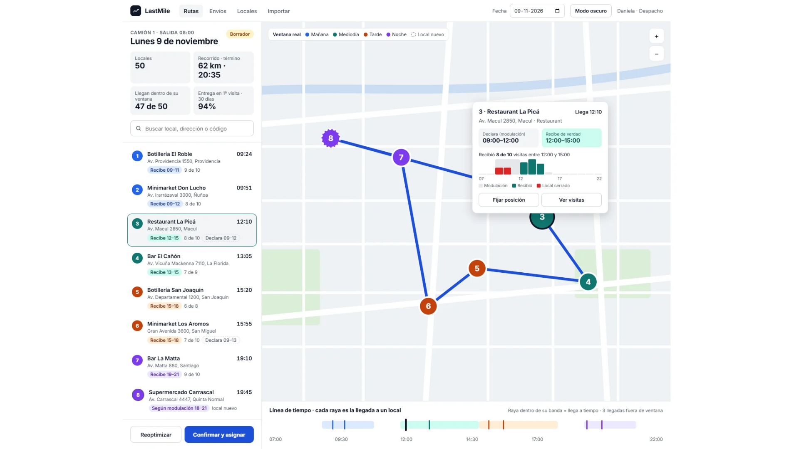
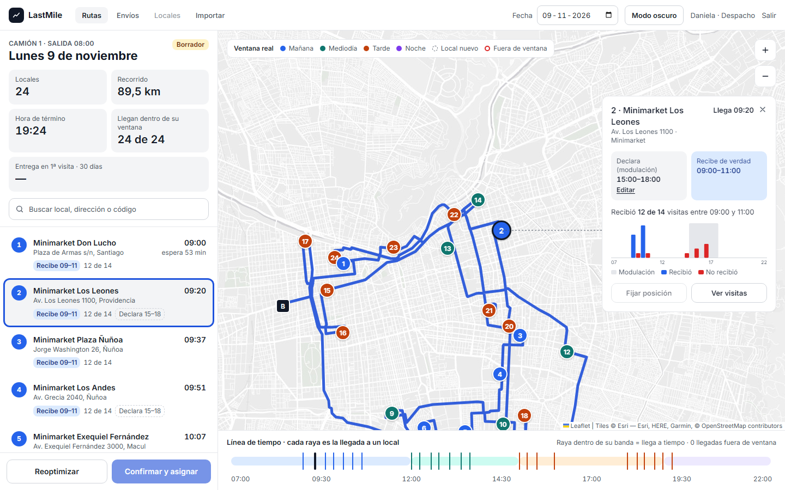
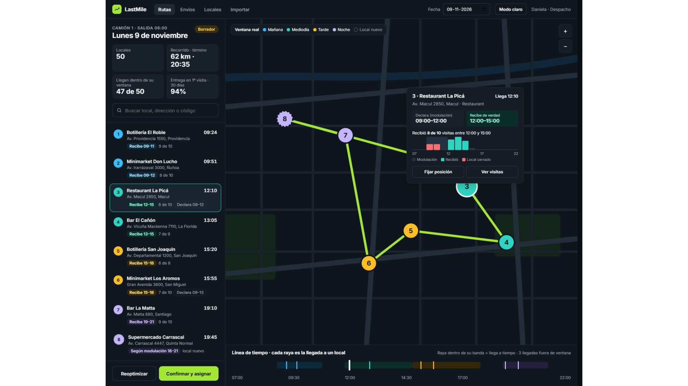
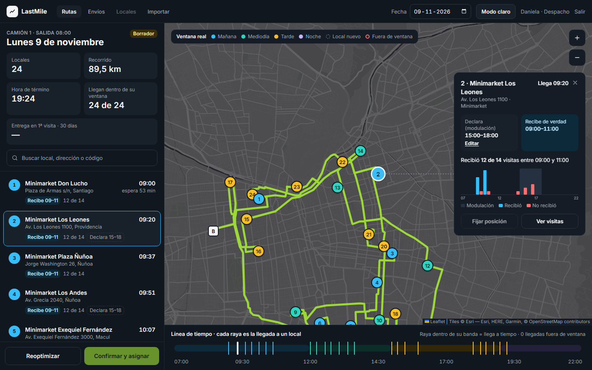

# Pantalla de rutas (HU-27): referencia e implementación

| | Referencia aprobada | Implementación (Sprint 3, semilla de 24 paradas, 1440×900) |
|---|---|---|
| Claro |  |  |
| Oscuro |  |  |

Las capturas de implementación muestran la tarjeta de detalle de un local cuya
modulación no coincide con su ventana real: Minimarket Los Leones declara
15–18, pero recibe 09–11.

## Diferencias intencionales

1. **Mapa base: Esri Gray Canvas en vez de CARTO.** *(Sprint 5, #57: ahora el
   valor por defecto es Stadia Alidade Smooth, que tiene detalle hasta zoom 20;
   ver [mapa-base.md](mapa-base.md). Lo que sigue describe HU-27.)*
   - Desde 2026, los mapas base públicos de CARTO exigen API key. Sin ella,
     cada tesela muestra "API KEY REQUIRED".
   - Por defecto se usa Gray Canvas de Esri (claro y oscuro), igual de neutro
     y sin key.
   - Para volver a CARTO con una key: `VITE_TILE_URL_LIGHT`,
     `VITE_TILE_URL_DARK` y `VITE_TILE_ATTRIBUTION` (ver
     `frontend/src/lib/config.ts`).
2. **KPIs.**
   - Grilla 2×2 (Locales, Recorrido, Hora de término, Llegan dentro de su
     ventana) más "Entrega en 1ª visita · 30 días" en ancho completo, con un
     valor por línea. La referencia junta recorrido y término en un mismo
     bloque.
   - La entrega en primera visita muestra "—", porque el backend aún no la
     calcula.
3. **Franja de los bares.** La franja sale del **inicio** de la ventana real.
   Los bares de la semilla reciben 18–20, así que quedan en la franja Tarde
   (naranja), no en Noche, que empieza a las 19.
4. **Estado de la ruta.** Siempre dice "Borrador", y "Confirmar y asignar" está
   deshabilitado ("Disponible en HU-17"). "Fijar posición" está deshabilitado
   ("Disponible en HU-15").
5. **Nav.** "Locales" está deshabilitado porque no hay listado de locales; el
   detalle de un local se abre con "Ver visitas". Se agrega "Salir" para cerrar
   sesión.
6. **Hora estimada.** Es la de inicio de la entrega (llegada + espera, HU-14),
   con "espera N min" debajo. La raya de la línea de tiempo va en esa hora.
7. **Alerta en la línea de tiempo.** Sale del cálculo de HU-14 (la entrega
   empezaría con la ventana real cerrada), no de la banda fija de la franja.
   Por eso un bar que llega a las 19:14 está a tiempo: su ventana es 18–20.
8. **Histograma de la tarjeta.** Barras de entregas y de no entregas lado a
   lado por hora, con la modulación como banda gris de fondo.
9. **Datos.** "12 de 14" en vez de "8 de 10": son los de la semilla (#52).
10. **Local nuevo.** El estilo existe (borde punteado y "Según modulación ·
    local nuevo"), pero no aparece en las capturas porque todos los locales
    semilla tienen historial.
