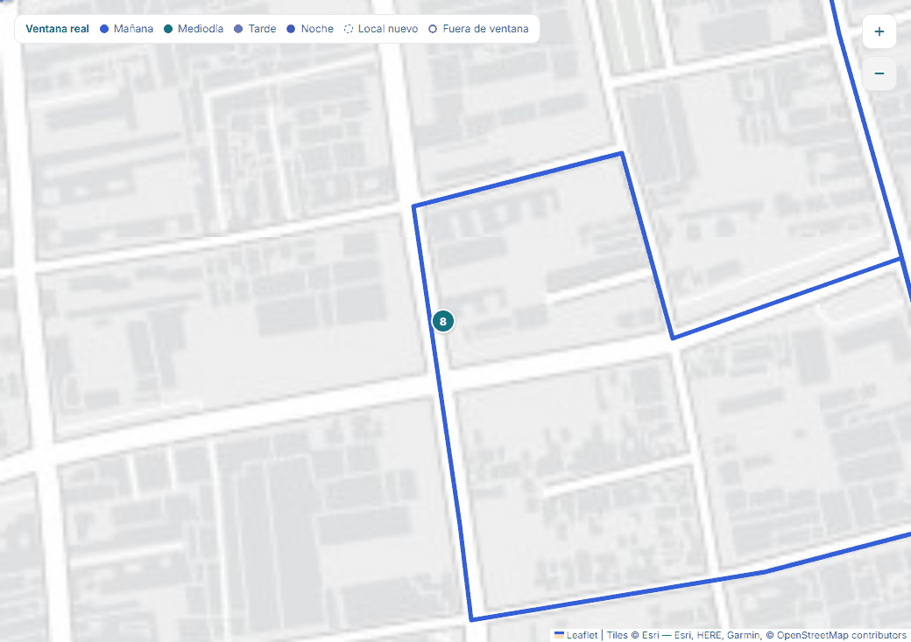
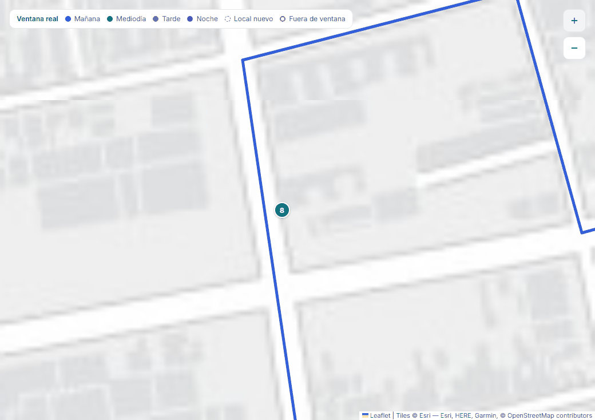
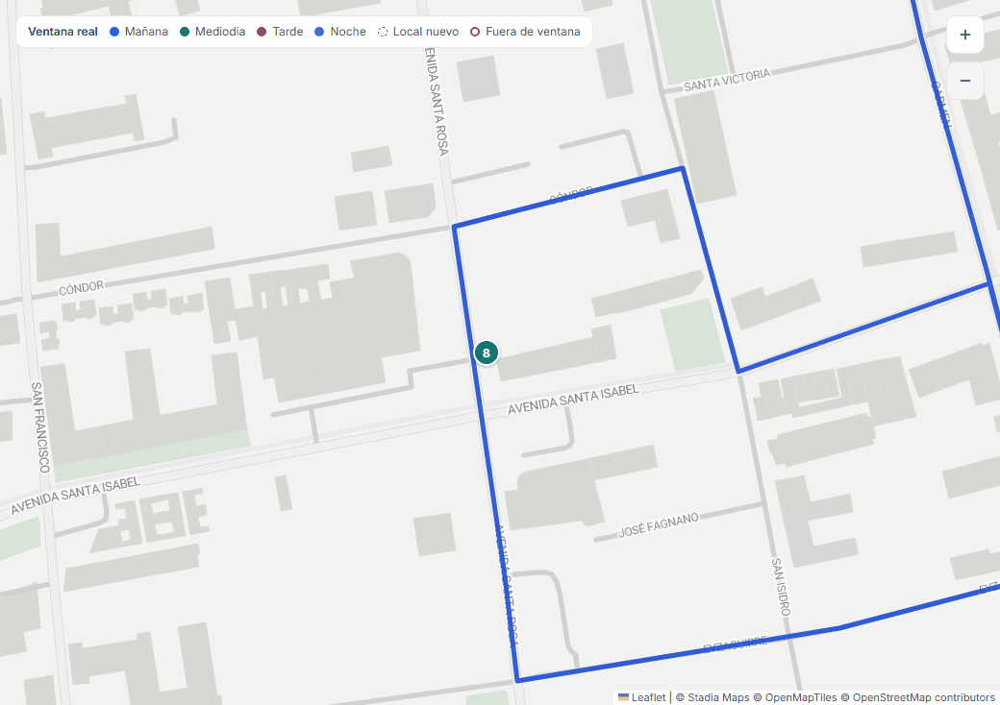
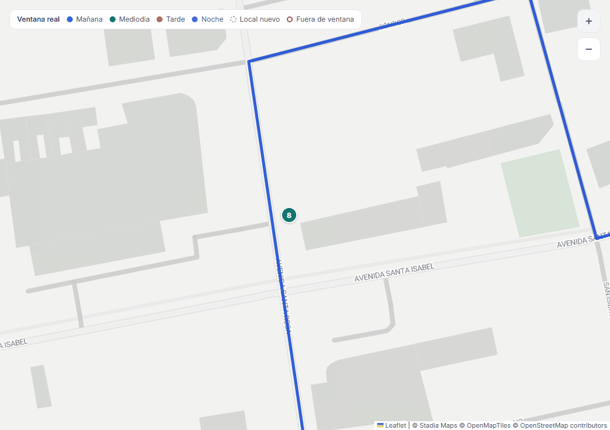
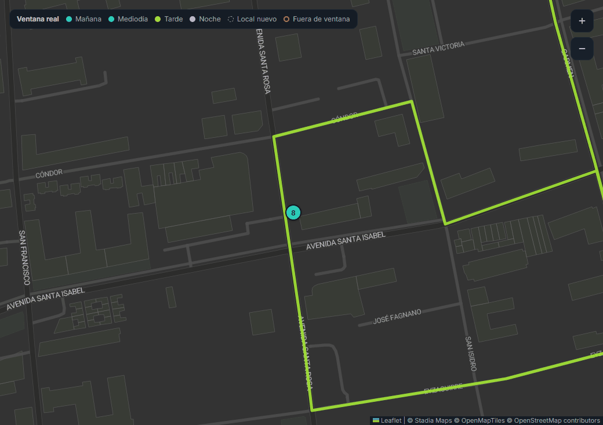
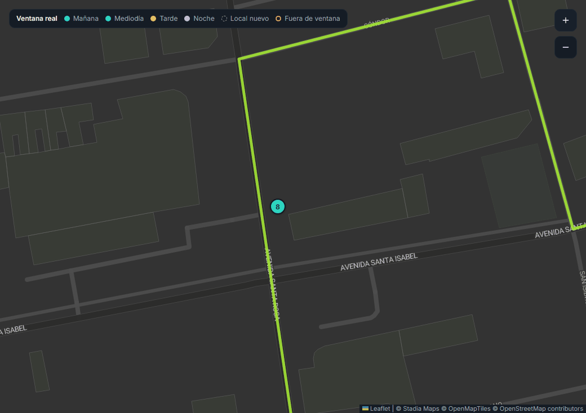
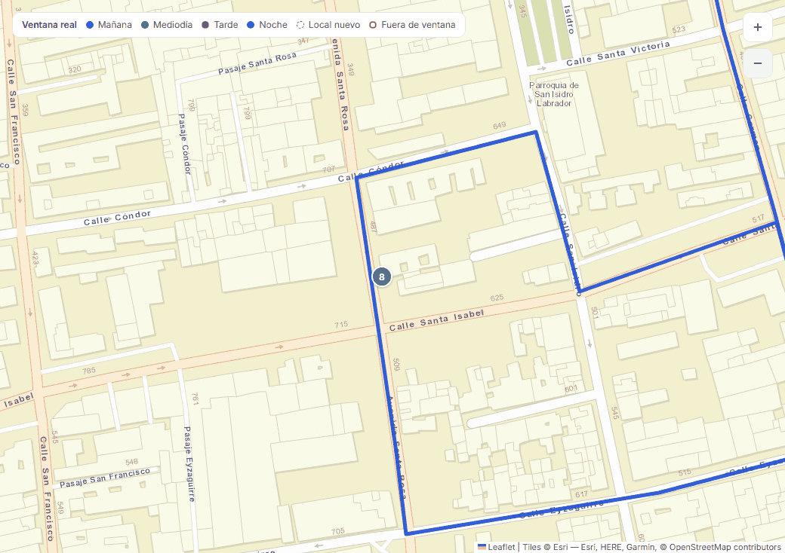
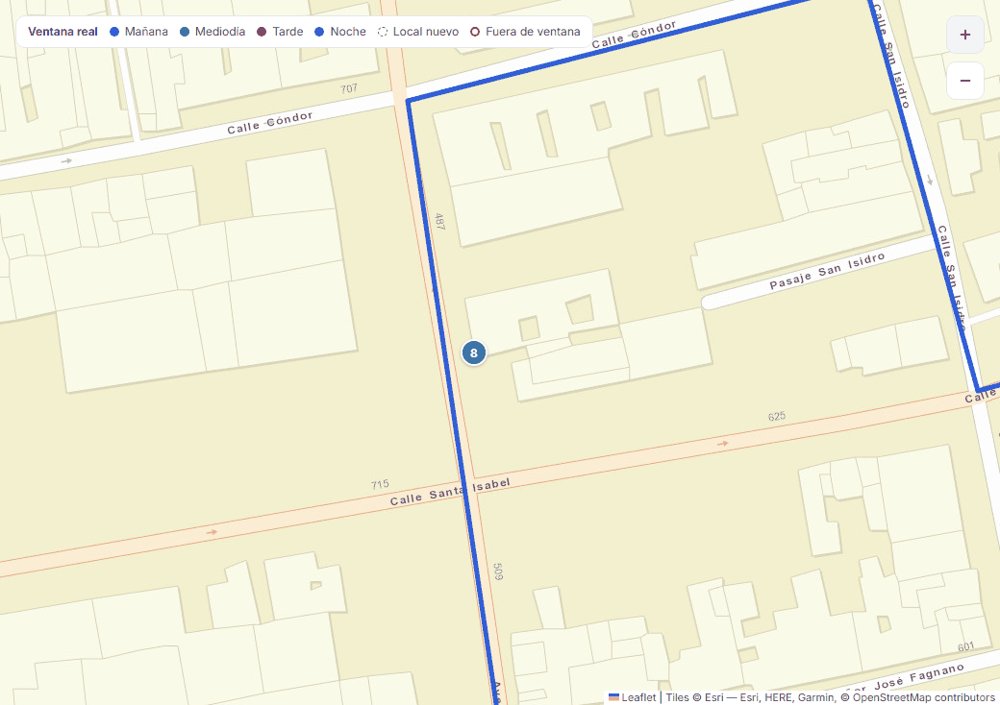
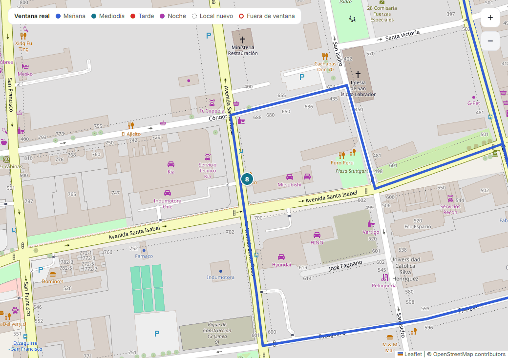
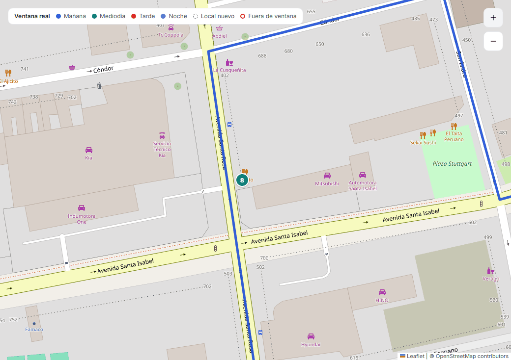

# Mapa base: proveedores (#57)

Con mucho zoom, el mapa de HU-27 (Esri Gray Canvas) se ve borroso. **Esri no
tiene teselas de Gray Canvas más allá del zoom 16**: desde el 17 devuelve una
tesela de relleno de 2,5 KB, y Leaflet amplía la del 16. Para leer la calle de
cada local hace falta detalle real hasta zoom 19–20.

El proveedor se elige con `VITE_TILE_PROVIDER`, y su key con
`VITE_TILE_API_KEY` (ver `frontend/src/lib/config.ts`). **Por defecto,
`stadia`**, porque en localhost funciona sin key. El dueño del producto elige
el definitivo antes de HU-24.

## Comparación

Revisada el 12 de noviembre de 2026. Las teselas se probaron sin key sobre Av.
Santa Rosa 500, en los zooms 16 a 20.

| `VITE_TILE_PROVIDER` | Estilo | Sin key | Detalle real hasta | Plan gratis | Uso comercial |
|---|---|---|---|---|---|
| `stadia` (por defecto) | Alidade Smooth y Smooth Dark: neutro, claro y oscuro | En localhost sí. En otro dominio, registrar el dominio o usar key | **20** | 200.000 créditos al mes, sin tarjeta. Al pasarse da error, no cobra | No en el plan gratis. Starter: USD 20 al mes, 1 M de créditos |
| `maptiler` | Dataviz y Dataviz Dark: neutro | **No** (403) | 20 | Cuota mensual de sesiones y requests. Se suspende al llegar al límite | No en el plan gratis (solo pruebas, prototipos y uso no comercial) |
| `esri-gris` (HU-27) | Gray Canvas claro y oscuro | Sí | **16**: borroso desde el 17 | — | Producción con cuenta de ArcGIS Location Platform |
| `esri-calles` | World Street Map: con color, no neutro | Sí | 19 | — | Igual que el anterior |
| `osm` | OpenStreetMap estándar: con color, sin modo oscuro | Sí | 19 | Servidor comunitario | **Solo para desarrollo.** La política de la OSMF prohíbe el uso intensivo sin permiso y exige User-Agent y Referer |
| `carto` | Positron y Dark Matter (el diseño original) | **No**: "API KEY REQUIRED" desde 2026 | 20 | Con cuenta de CARTO | Según contrato |

**Lectura:**

- **Para staging y una demo**, Stadia o MapTiler, porque los dos son neutros
  y se parecen al diseño. El plan gratis de los dos es no comercial.
- **Para producción** con clientes que pagan hace falta un plan pagado: Stadia
  Starter, MapTiler Flex o una cuenta de Esri.
- **OSM estándar no sirve más allá de desarrollo.**

Fuentes:

- [Stadia: precios](https://stadiamaps.com/pricing/),
  [costo del plan gratis](https://stadiamaps.com/learn/what-does-a-free-map-api-cost/) y
  [límites](https://docs.stadiamaps.com/limits).
- [MapTiler: planes](https://www.maptiler.com/cloud/plans) y
  [términos](https://www.maptiler.com/terms/cloud/).
- [OSMF: política de uso de teselas](https://operations.osmfoundation.org/policies/tiles/).

## Capturas (1440 × 900, Botillería Santa Rosa)

| Proveedor | Zoom 18 | Zoom 19 |
|---|---|---|
| `esri-gris` (HU-27) |  |  |
| `stadia` |  |  |
| `stadia`, modo oscuro |  |  |
| `esri-calles` |  |  |
| `osm` (solo desarrollo) |  |  |

MapTiler y CARTO no tienen capturas porque piden key: sin ella, MapTiler
devuelve 403 y CARTO una tesela que dice "API KEY REQUIRED". Con una key se
capturan igual: `VITE_TILE_PROVIDER=maptiler VITE_TILE_API_KEY=...`.

## Cómo pedir la key

**Ninguna key va en el repo.** Va en el `.env` local o en las variables de
staging. Como viaja en la URL de cada tesela, el navegador la ve: hay que
restringirla por dominio en el panel del proveedor.

- **Stadia:**
  1. Crea una cuenta en <https://client.stadiamaps.com/signup/>.
  2. Crea una *property*.
  3. Para staging, agrega el dominio en *Authentication*: así no hace falta key.
     Si prefieres key, genérala ahí y ponla en `VITE_TILE_API_KEY`.
  4. En localhost funciona sin nada de esto.
- **MapTiler:**
  1. Crea una cuenta en <https://cloud.maptiler.com/>.
  2. En *Account → Keys*, crea una key.
  3. En *Allowed HTTP origins*, deja solo el dominio de staging y
     `http://localhost:5173`.
  4. Ponla en `VITE_TILE_API_KEY` con `VITE_TILE_PROVIDER=maptiler`.
- **CARTO:** con una cuenta de CARTO, usa
  `VITE_TILE_PROVIDER=carto VITE_TILE_API_KEY=...`.

Después de cambiar una variable, reconstruye el frontend:
`docker compose up --build frontend`.
