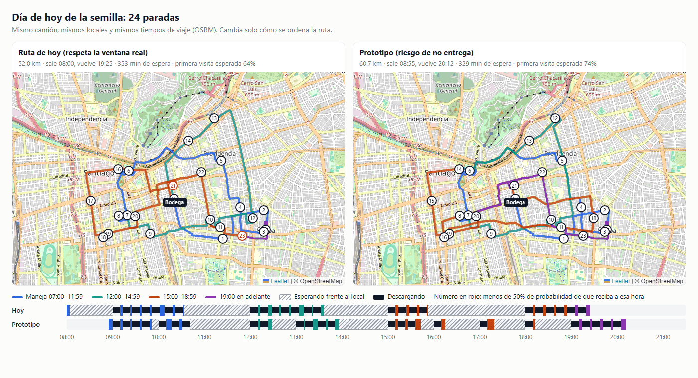
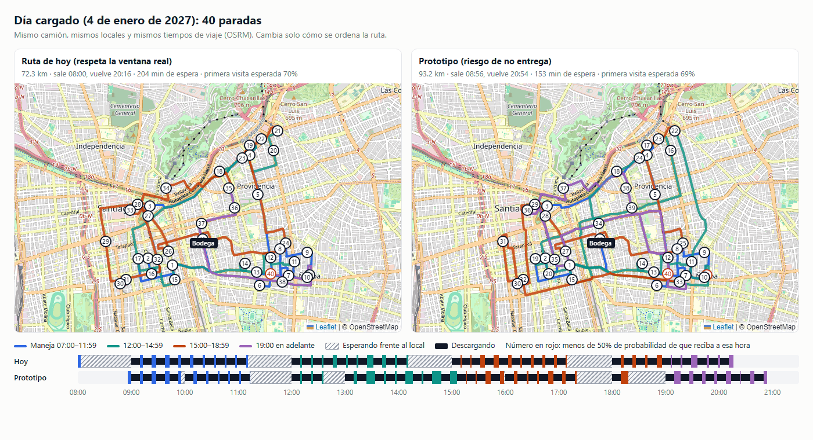

# Análisis de ventanas flexibles (base de HU-37)

> Documento para conversar con logística. Issue #87. Sprint 5.
> Nada de esto cambia cómo arma hoy la ruta LastMile: el prototipo está
> detrás de un interruptor apagado.

## La pregunta

Hoy LastMile arma la ruta con una regla rígida: **cada local tiene una
ventana real de dos horas** (la que aprende de las entregas pasadas) y el
camión **no descarga antes de que abra**. Si llega temprano, espera.

En el día de hoy de la semilla (24 paradas), esa regla produce:

- un camión que **recorre la zona tres veces**: minimarkets en la mañana,
  botillerías al mediodía, restaurantes en la tarde y bares en la noche;
- **esperas largas**: 55 min frente a la primera parada (sale a las 08:00 y
  el local abre a las 09:00), 86 min en la Botillería Santa Rosa, 83 min en
  el Restaurant Barrio Italia y 127 min en el Bar El Tranque;
- una jornada de **08:00 a 19:25** (última entrega 19:19).

La pregunta para logística es: **¿conviene que el camión deje de forzar la
ventana y, en cambio, busque el horario con menos riesgo de que el local no
reciba, aunque a veces llegue fuera de su ventana?** Eso es lo que propone
HU-37.

## Qué probamos

Armamos un **prototipo** que ordena la ruta con otro objetivo. En vez de "nunca
fuera de la ventana", busca **el costo total más bajo**, sumando:

| Qué cuenta | Supuesto usado (en pesos) |
|---|---|
| Una entrega que no se concreta en primera visita | $60.000 × la probabilidad de que el local no reciba a esa hora |
| Cada minuto de jornada (de que sale de bodega a que vuelve) | $250 (conductor y peoneta) |
| Cada minuto esperando frente a un local, además | $50 |
| Cada km | $700 |

**Estos montos son supuestos para la conversación, no costos medidos.** Se
cambian en la configuración (`routing.optimizer.risk.*`) sin tocar código. Es
lo primero que logística debería corregir.

Además, el prototipo puede hacer dos cosas que la ruta de hoy no hace:

1. **Elegir la hora de salida.** Si iba a esperar en la primera parada, sale
   más tarde de bodega (hasta 3 horas después).
2. **Decidir si espera o descarga.** Al llegar a un local, compara descargar ya
   con esperar a la hora siguiente (a lo más 2 horas), y elige lo que cueste
   menos según la probabilidad de que reciba a cada hora.

### ¿De dónde sale la probabilidad de que un local reciba?

Para cada local y cada hora del día, juntamos dos fuentes:

- **Lo que pasó en sus visitas a esa hora** (cuántas veces recibió y cuántas no).
- **Lo que el local declara (su modulación)**, que pesa como 2 visitas: 60% de
  probabilidad dentro de la modulación y 20% fuera de ella.

Con muchas visitas a una hora, manda el historial. Con pocas o ninguna, manda
la modulación. Hay una excepción: **si el camión ya fue al local dentro de su
modulación y nunca le recibieron, la modulación deja de contar**. Así, un bar
que dice "recibo de 9 a 12" pero en la práctica recibe después de las 19 no
atrae visitas a las 9 de la mañana.

Ejemplo, el Minimarket Cañas (recibe de 9 a 11 y declara de 9 a 12):

| Hora | Visitas en el historial | Probabilidad de que reciba |
|---|---|---|
| 09:00 | 5 de 6 aceptadas | 78% |
| 10:00 | 7 de 8 aceptadas | 82% |
| 11:00 | sin visitas, dentro de su modulación | 60% |
| 15:00 | 0 de 2 aceptadas | 10% |

## Cómo medimos

Usamos **los dos días de la semilla**, con el mismo camión (Camión 3/4), los
mismos locales y los **mismos tiempos de viaje por calle (OSRM)**. Cambia solo
la forma de ordenar la ruta. Las dos rutas se miden con la misma vara: la misma
probabilidad por local y hora, y 10 minutos de descarga por parada.

- **Día de hoy:** 24 paradas (los 4 tipos de local).
- **Día cargado (4 de enero de 2027):** 40 paradas, con más locales que los que
  caben cómodos en un camión.

## Resultados

| | Hoy: ruta actual | Hoy: prototipo | Día cargado: ruta actual | Día cargado: prototipo |
|---|---|---|---|---|
| Km (con vuelta a bodega) | 52,0 | 60,7 (+8,7) | 72,3 | 93,2 (+20,9) |
| Sale de bodega | 08:00 | 08:55 | 08:00 | 08:56 |
| Última entrega | 19:19 | 20:05 | 20:11 | 20:50 |
| Vuelve a bodega | 19:25 | 20:12 | 20:16 | 20:54 |
| Jornada | 11 h 25 min | 11 h 16 min (−9 min) | 12 h 16 min | 11 h 58 min (−18 min) |
| Minutos de espera | 353 | 329 (−24) | 204 | 153 (−51) |
| **Entrega en primera visita esperada** | **64%** | **74% (+10 puntos)** | **70%** | **69% (−1 punto)** |
| Entregas fallidas esperadas | 8,5 de 24 | 6,2 de 24 | 12,1 de 40 | 12,5 de 40 |
| Paradas fuera de la ventana real | 0 | 1 | 1 | 7 |

Con más tiempo de cálculo (60 segundos en vez de 10), el día de hoy da lo
mismo. El día cargado mejora: 79,8 km, primera visita esperada de 71% y vuelta
a las 21:02. **En el día cargado el prototipo todavía no es estable.**

### Día de hoy



Arriba, cada mapa pinta la línea según la hora a la que el camión maneja ese
tramo. Abajo, la línea de tiempo muestra el día del camión: en color cuando
maneja, en negro cuando descarga y **en gris rayado cuando espera**.

### Día cargado



## Qué aprendimos, en simple

1. **El mayor ahorro es el más sencillo: salir más tarde.** Hoy el camión sale
   a las 08:00 para esperar casi una hora frente al primer local. Saliendo a
   las 08:55, con la misma ruta, la jornada baja de 11 h 25 min a **10 h 30
   min** el día de hoy (y de 12 h 16 min a 11 h 20 min el día cargado), sin
   ningún riesgo. No necesita el prototipo: basta con fijar la hora de salida
   de bodega según la primera parada.

2. **La ruta de hoy entrega a dos bares a una hora en la que no hay evidencia
   de que reciban.** El Bar Bilbao (18:27) y el Bar Dublé Almeyda (18:55) solo
   han recibido después de las 19, pero LastMile aprendió su ventana como
   18:00–20:00. El prototipo los deja después de las 19, y eso explica más de
   la mitad de su mejora en primera visita (de 64% a 74%). El resto viene de
   llevar otros dos bares después de las 19 y dos botillerías a las 13, horas
   en que su historial muestra que reciben mejor. Lo registramos como
   hallazgo (#99): se puede corregir en el aprendizaje de la ventana real, sin
   cambiar el objetivo de la ruta.

3. **Las esperas largas no se arreglan reordenando.** Los locales de cada
   franja reciben en horarios separados: mañana, mediodía, tarde y noche. Con
   24 paradas, el camión termina los minimarkets a las 10:30 y las botillerías
   recién abren a las 12:00. El prototipo baja la espera muy poco (de 353 a
   329 min) porque no hay trabajo para llenar ese hueco. Las alternativas reales
   son de operación, no de algoritmo:
   - darle al camión otro trabajo en los huecos (retiros, otra zona);
   - repartir en dos turnos o dos camiones (HU-16);
   - pedirle a algunos locales que reciban en otra franja.

4. **Con el historial de hoy, la flexibilidad tiene poco espacio.** Cada local
   de la semilla tiene visitas solo en unas pocas horas (las de su ventana y
   algunas de rechazo). Para las demás horas, el prototipo no sabe si el local
   recibe y usa su modulación, que en más de un tercio de los locales es
   falsa. En la práctica, flexibilizar solo sirve donde hay **visitas en horas
   distintas**: el beneficio crece con historial real y variado.

5. **El prototipo cambia km por menos riesgo y menos jornada, y no siempre
   gana.** El día de hoy hace +8,7 km para subir 10 puntos de primera visita.
   El día cargado hace +21 km y no mejora la primera visita. Si eso conviene o
   no depende de los costos de la tabla de supuestos.

## Preguntas para logística

1. **¿Cuánto cuesta de verdad una entrega fallida?** Volver otro día, el
   reclamo del local, el producto que no se vende. Hoy usamos $60.000.
2. **¿Cuánto cuesta una hora de camión con conductor y peoneta?** Hoy usamos
   $15.000 por hora.
3. **¿Se puede salir de bodega a distintas horas según la ruta?** Por ejemplo,
   a las 08:55 si el primer local abre a las 09:00. Es el ahorro más fácil.
4. **¿Un local que dice "recibo de 9 a 12" suele recibir a las 12:30?** Es
   decir, ¿la ventana es un borde duro o una preferencia? Eso define cuánta
   flexibilidad tiene sentido.
5. **¿Qué se hace hoy con el camión entre franjas?** Si ya hay retiros u otro
   trabajo, las esperas del análisis están sobreestimadas.
6. **¿Hay locales donde convenga probar a otra hora** para aprender si reciben?
   Sin esas visitas, ningún algoritmo puede saberlo.

## Recomendación

- **Ahora:** fijar la hora de salida según la primera parada (punto 1) y
  corregir la ventana real de los bares (#99). Son cambios chicos, sin riesgo
  para la primera visita.
- **HU-37 (Sprint 7):** dejar el objetivo por riesgo detrás del interruptor
  hasta validar los costos con logística y tener historial con visitas en horas
  variadas. Antes de encenderlo, falta:
  - que la hora estimada de la pantalla use la misma regla (hoy sigue esperando
    a que abra la ventana);
  - mostrar la probabilidad de que el local reciba a la hora de llegada;
  - estabilizar el resultado en días cargados (más tiempo de cálculo o un
    mejor punto de partida).

---

## Para el equipo técnico

- **Interruptor:** `routing.optimizer.objective` vale `windows` (por defecto,
  la regla de hoy) o `risk` (el prototipo). En un contenedor se enciende con
  la variable `ROUTING_OPTIMIZER_OBJECTIVE=risk` en `delivery-service`
  (`docker-compose.yml` no la define). Con `risk`, la ruta lleva en
  `optimizerNote` el aviso "Prototipo HU-37…".
- **Costos:** están en `routing.optimizer.risk.*` (`failed-delivery`, `per-km`,
  `per-shift-minute`, `per-wait-minute`, `max-wait-minutes` y
  `max-departure-delay-minutes`), en `application.yml`.
- **Código:** `algorithm/optimizer/flexible/`, con estas piezas:
  - `AcceptanceCurve`: la probabilidad por hora;
  - `FlexibleTruckRoute`: el horario flexible, más el modo `RIGID` para medir
    la ruta de hoy con la misma vara;
  - `RiskConstraints`: el objetivo;
  - `FlexibleRouteOptimizer`: parte de la ruta VRPTW de hoy y la mejora con la
    misma búsqueda tabú. Si no es factible, devuelve la de hoy.

  No se tocaron `TimeWindowLearningService`, `RouteOptimizationService`,
  `TruckRoute` ni `RouteConstraints`.
- **Medición:** `FlexibleWindowsAnalysisIT` no corre en CI. Se corre a mano y
  escribe `target/analisis-ventanas-flexibles/resultados.json`:
  ```bash
  ./mvnw -o verify -Dit.test=FlexibleWindowsAnalysisIT -Dtest=none -Dsurefire.failIfNoSpecifiedTests=false \
    -Danalisis=true -Dosrm=https://router.project-osrm.org
  ```
  La línea base reproduce los números del plan: 08:00 a 19:19, 55 min en la
  parada 1 y 86 min en la Botillería Santa Rosa.
- **Figuras:** `analisis-ventanas-flexibles/figura-ventanas.html` y
  `ventanas.js` (Playwright) dibujan los mapas y la línea de tiempo desde
  `resultados.json`. Las líneas siguen las calles con OSRM y el mapa es de
  OpenStreetMap.
- **Límites del prototipo:**
  - decide la espera parada por parada, sin mirar cómo atrasa a las
    siguientes;
  - el tiempo de descarga es fijo (10 min), como en `main` antes de HU-15;
  - la probabilidad usa la hora de inicio de la descarga, sin interpolar entre
    horas.
