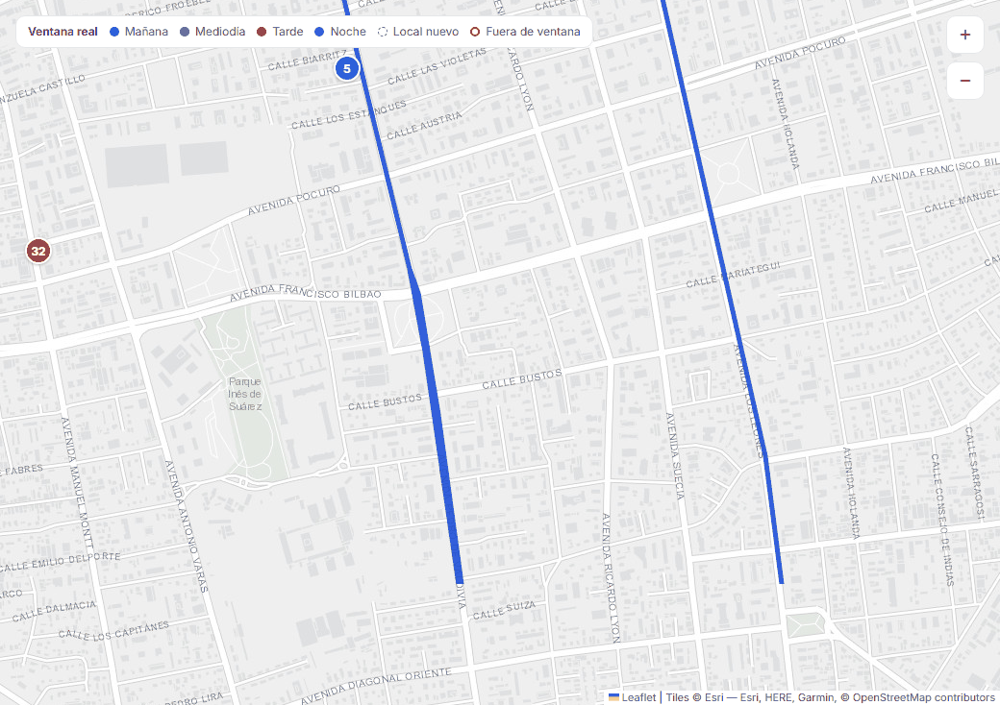
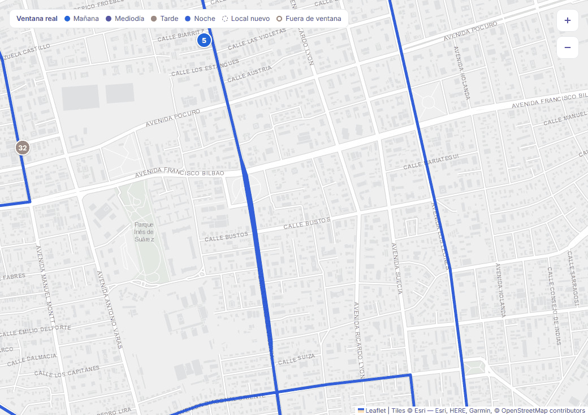
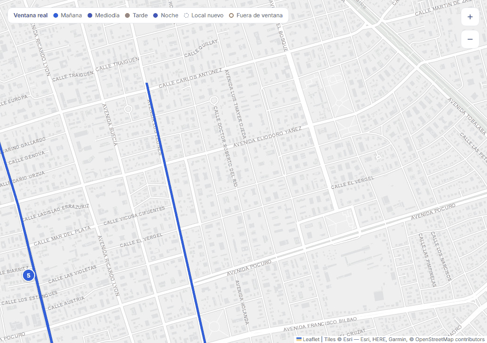
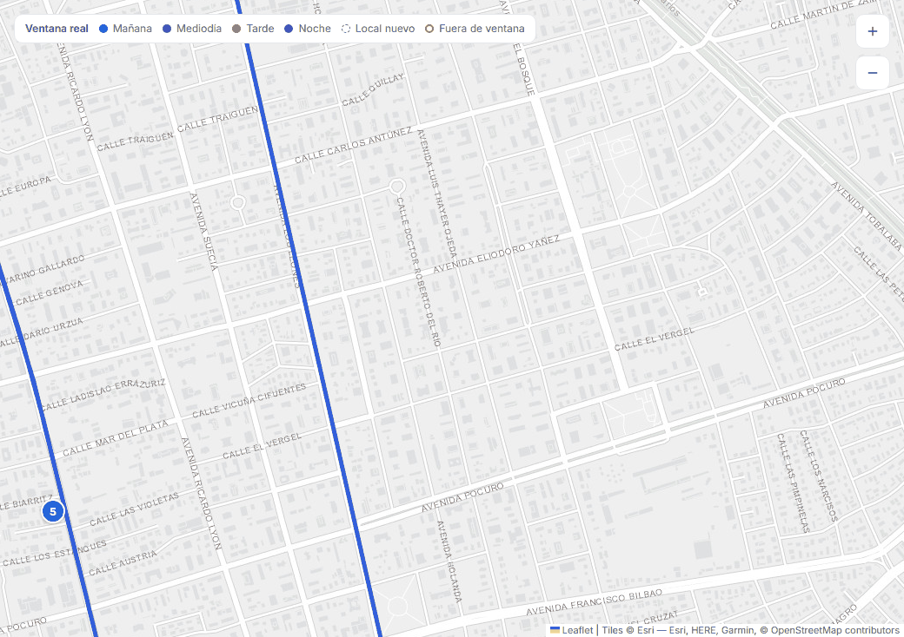

# Redibujo de la polilínea al arrastrar el mapa (#86)

## Causa

Leaflet no vuelve a dibujar las líneas mientras arrastras: mueve lo que ya
estaba dibujado y lo redibuja recién al soltar (`moveend`). Lo que se dibujó
cubre la pantalla más un margen (`padding`) de 0,1, o sea un 10 % por lado.
Con el renderer canvas de HU-32 (`preferCanvas`), al arrastrar más de ese 10 %
la línea aparece cortada en el borde del canvas, y se completa al soltar.

Con la ruta completa en pantalla no pasa, porque toda la línea cae dentro del
canvas. Se ve con zoom, cuando la línea sale de la pantalla.

## Arreglo

Solo la polilínea de la ruta usa un renderer SVG propio, con un margen de una
pantalla por lado (`L.svg({ padding: 1 })`). Los marcadores ya eran HTML
(`divIcon`) y no cambian.

**Por qué SVG y no `L.canvas({ padding: 1 })`:** un canvas con ese margen
tendría 9 veces los píxeles del mapa (3 × 3 pantallas), 4 veces más en una
pantalla retina, y se borraría y pintaría entero en cada `moveend`. El SVG solo
guarda el trazado, que Leaflet ya simplifica por zoom (`smoothFactor` 1,5,
HU-32).

En react-leaflet, el renderer va como prop de `<Polyline>`. Dentro de
`pathOptions` no tiene efecto, porque esas opciones solo se aplican con
`setStyle`.

## Medición

Build de producción del frontend (`vite preview`), mismo stack, Chromium de
Playwright 1.48 a 1440 × 900 y día cargado (40 paradas). Antes = `main`;
después = esta rama.

### La línea mientras arrastras

[`medir-arrastre.js`](medir-arrastre.js) acerca el mapa 3 niveles y hace 3
arrastres:

- 350 px a la izquierda;
- 250 px hacia abajo;
- uno diagonal, de 300 px a la derecha y 200 px hacia arriba.

En cada uno captura el mapa con el botón aún apretado y después de soltar, en
la misma posición, y cuenta los píxeles del color de la ruta.

| Arrastre | Antes: línea visible al arrastrar | Después |
|---|---|---|
| 350 px a la izquierda | 100 % (la línea no salía por ese borde) | 100 % |
| 250 px hacia abajo | **88 %** | **100 %** |
| Diagonal | **60 %** | **100 %** |

| Antes, arrastrando | Después, arrastrando |
|---|---|
|  |  |
|  |  |

### La mejora de HU-32 se mantiene

[`../hu-32/medir-pantalla.js`](../hu-32/medir-pantalla.js), igual que en HU-32:
12 arrastres y 4 zooms con la CPU limitada ×4, dos corridas de cada lado. El
script ahora acepta `HOY=` porque tenía fijo el día de su medición. Los datos
están en [`mediciones.json`](mediciones.json).

| Mover el mapa (CPU ×4) | Antes (corrida 1 / 2) | Después (corrida 1 / 2) |
|---|---|---|
| Consultas a OSRM | 0 / 0 | 0 / 0 |
| JavaScript | 617 / 607 ms | 588 / 599 ms |
| Estilo y layout | 1.110 / 1.102 ms | 1.068 / 1.150 ms |
| Duración total | 8,7 / 9,0 s | 8,3 / 8,6 s |
| Cuadro mediano / p95 | 16,7 / 33,3 ms | 16,7 / 33,2–33,3 ms |
| Cuadros de más de 50 ms | 3 / 2 | 2 / 2 |
| Tareas largas | 201 / 132 ms | 200 / 135 ms |

Abrir la pantalla 4 veces: 1 consulta a OSRM antes (caché vacía) y 0 después
(caché llena), igual que en HU-32.

**Lectura:**

- Dibujar la línea en SVG con margen no cuesta más JavaScript ni más layout:
  las diferencias están dentro del ruido entre corridas.
- Los números absolutos son más bajos que los de HU-32 (678 / 777 ms) porque
  esta medición usa el build de producción y otra máquina en otro momento. Lo
  que se compara es antes contra después en la misma corrida.
