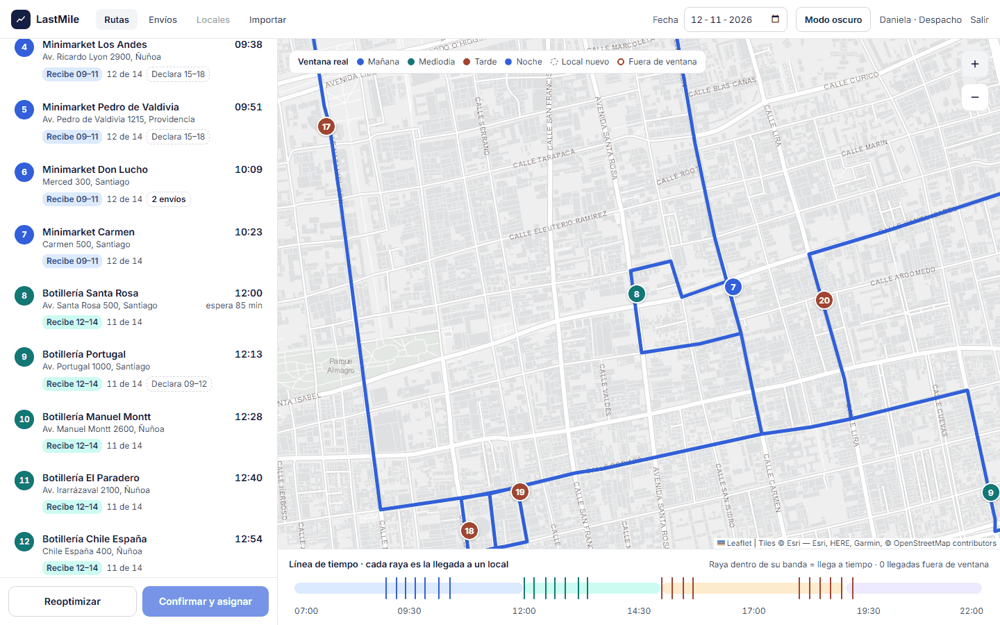
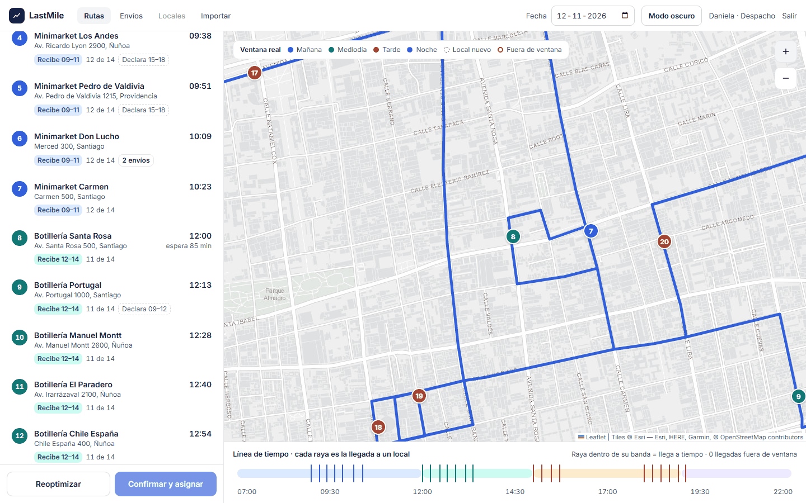
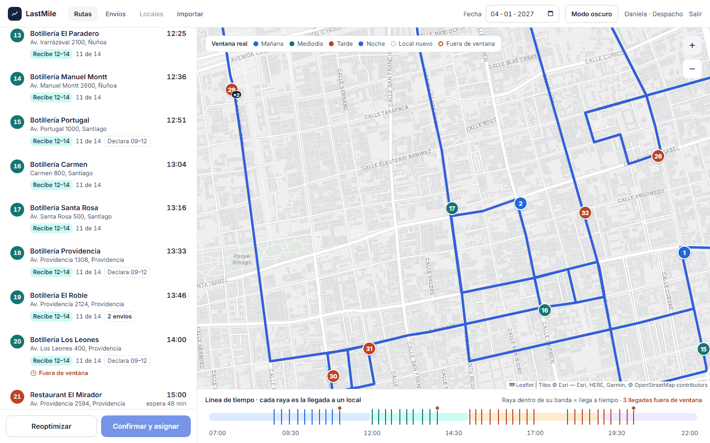
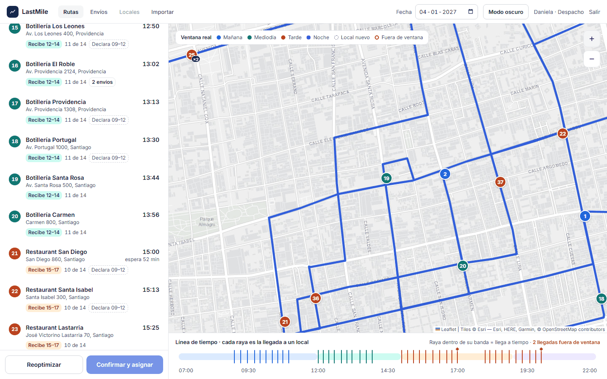
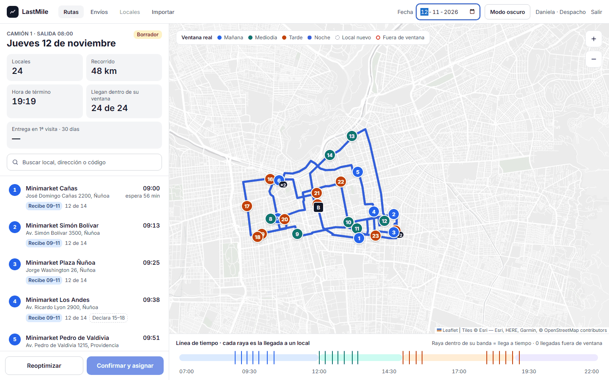
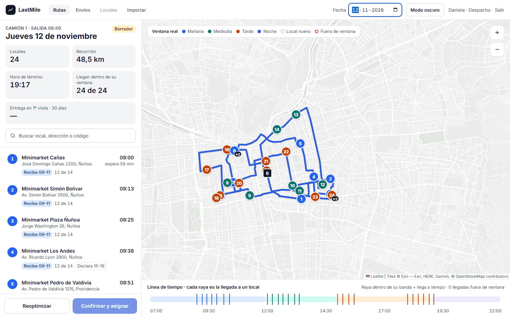
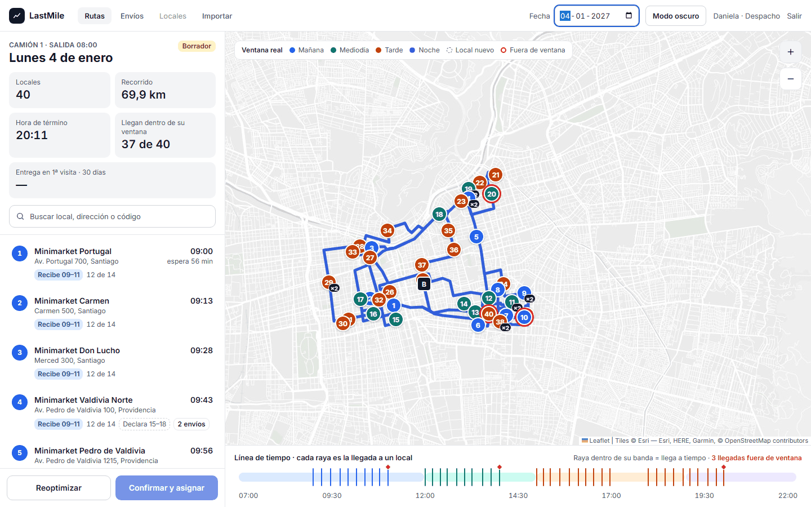
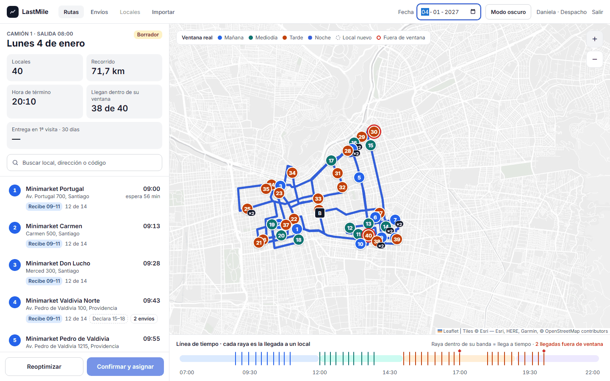

# Vueltas de la ruta (#85): diagnóstico y medición

Al probar la pantalla de rutas pareció que la línea rodea manzanas sin
necesidad, por ejemplo alrededor de Av. Santa Rosa 500 (Botillería Santa Rosa).

## Qué se revisó

### 1. ¿El punto cae en una calle lateral?

OSRM arma la ruta desde el punto de calle más cercano a la coordenada del
local (`/nearest`). Si un local de esquina queda más cerca de la calle
transversal que de la suya, el camión "llega" por la transversal.
`infra/seed/tools/revisar_enganche.py` lo revisa para los 40 locales. **8
enganchaban en otra calle:**

| # | Local | Enganchaba en | Su calle estaba a |
|---|---|---|---|
| 2 | Av. Providencia 2124 | Arquitecta Montserrat Palmer Trias (11 m) | 64 m |
| 4 | Av. Irarrázaval 3550 | calle sin nombre (36 m) | 117 m |
| 19 | Av. Libertador Bernardo O'Higgins 1302 | Nataniel Cox (8 m) | 108 m |
| 29 | Av. Irarrázaval 3000 | Av. Suecia (17 m) | 32 m |
| 31 | Av. Providencia 2594 | Luis Thayer Ojeda (29 m) | 41 m |
| 32 | Av. Manuel Montt 500 | Alberto Magno (5 m) | 13 m |
| 33 | Av. Pedro de Valdivia 100 | Av. Nueva Providencia (33 m) | 53 m |
| 38 | Carmen 800 | Copiapó (11 m) | 15 m |

Los 8 se movieron en la semilla al punto de su propia calle que devuelve OSRM
`/nearest`. Después del cambio, el script informa 0. Santa Rosa 500 **no**
estaba en la lista: engancha en Av. Santa Rosa, a 7,5 m.

### 2. La vuelta en Santa Rosa 500 la obliga el sentido del tránsito

En el centro de Santiago, las calles norte-sur alternan el sentido. Se probó
con OSRM cada calle en los dos sentidos: lo que en un sentido son 300–440 m, en
el otro son 1.300–1.700 m.

| Calle (tramo de la semilla) | Sentido |
|---|---|
| Av. Santa Rosa (400–600) | solo hacia el norte |
| Carmen (500–800) | solo hacia el sur |
| Lira (550–700) | solo hacia el norte |

Por eso, de Minimarket Carmen (Carmen 500) a Botillería Santa Rosa, el camión:

1. baja por Carmen;
2. dobla al oeste por Eyzaguirre;
3. sube por Santa Rosa hasta el 500.

Para seguir a Botillería Portugal, tiene que seguir al norte por Santa Rosa,
cruzar al este por Cóndor y Santa Isabel, y bajar por Carmen. Ese es el "rodeo
de la manzana" de la captura: no es un error del mapa ni del optimizador, que
ya usa la matriz de OSRM con los sentidos de cada calle.

### 3. Parámetros de `/route` y `/table`

| Parámetro | Qué hace | Efecto medido | Decisión |
|---|---|---|---|
| `continue_straight` (por defecto `true` en auto) | Al salir de una parada, el vehículo sigue en el sentido en que llegó (no hace U en la parada) | Con `false`: hoy 51,8 → 52,0 km; día cargado 72,6 → 72,3 km. Ahorra 235 m en un solo tramo por día | **Se mantiene el valor por defecto.** Un camión de 3/4 no da la vuelta en U en una avenida: lo realista es rodear la manzana |
| `approaches=curb` | Obliga a llegar con el local a la derecha (descargar sin cruzar la calle) | Agrega vueltas en las calles de doble sentido | No se usa: el conductor puede detenerse en cualquier lado de una calle de doble sentido |
| Mismo perfil en `/route` y `/table` | El optimizador ordena con los mismos sentidos con que se dibuja la línea | — | Ya era así |

**Qué es realista para un camión:**

- respetar el sentido de cada calle;
- no hacer U en una avenida;
- llegar por la calle de la dirección, que es lo que corrige el punto 1.

OSRM público usa el perfil de auto, así que no sabe de restricciones de altura,
peso o calles prohibidas para camiones. Un perfil de camión necesita un OSRM
propio, que entra con HU-36.

## Medición

Con un stack desechable y la semilla limpia, `infra/seed/tools/medir_ruta.py`
arma la ruta con el VRPTW. Sale de la bodega a las 08:00. Los km son hasta la
última parada.

| Día | km | Hora de término | Paradas fuera de ventana | Minutos fuera de ventana |
|---|---|---|---|---|
| Hoy (24 paradas): antes → después | 48,0 → 48,5 | 19:19 → 19:17 | 0 → 0 | 0 → 0 |
| Día cargado (40 paradas): antes → después | 69,9 → 71,7 | 20:11 → 20:10 | 3 → 2 | 1 → 0 |

Con el mismo orden de paradas, consultando solo a OSRM (ida y vuelta a la
bodega):

| Día | Antes | Después |
|---|---|---|
| Hoy | 51,8 km, 94 min manejando | 52,3 km, 93 min |
| Día cargado | 72,6 km, 133 min | 71,9 km, 129 min |

**Lectura:**

- Que el punto quede en la calle correcta no baja los km. En el día cargado
  hay 1,8 km más con el optimizador, porque ahora el camión llega de verdad
  por Av. Providencia, Irarrázaval o la Alameda, que tienen sentido o
  calzadas separadas.
- Lo que mejora es que la ruta va a donde está el local: termina 1–2 min antes
  y deja una parada menos fuera de ventana en el día cargado.
- Con el orden fijo, la diferencia es de ±0,7 km.

## Capturas (1440 × 900, mismo zoom)

Zoom 16 centrado en Botillería Santa Rosa:

| | Antes | Después |
|---|---|---|
| Hoy |  |  |
| Día cargado |  |  |

Ruta completa:

| | Antes | Después |
|---|---|---|
| Hoy |  |  |
| Día cargado |  |  |
